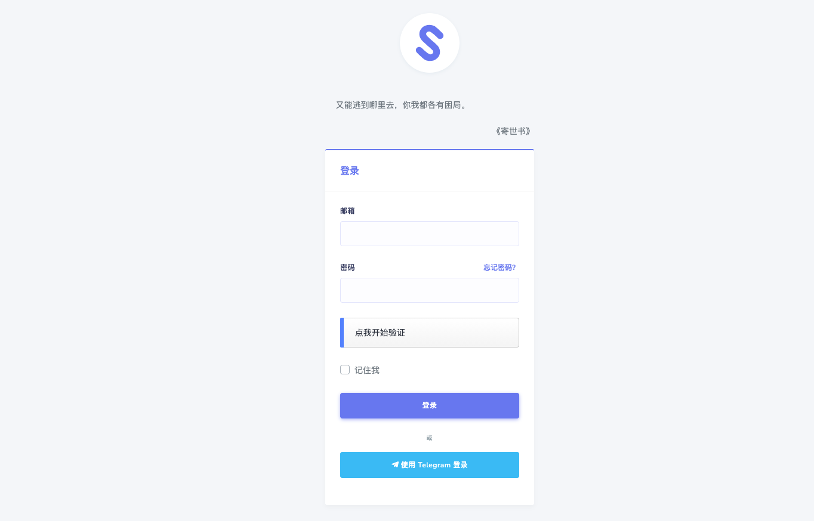
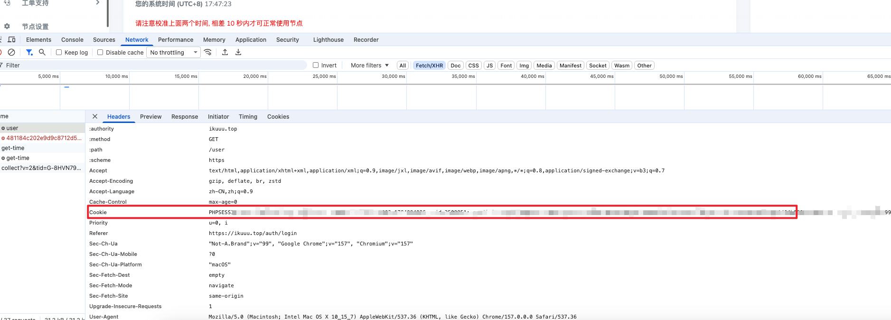
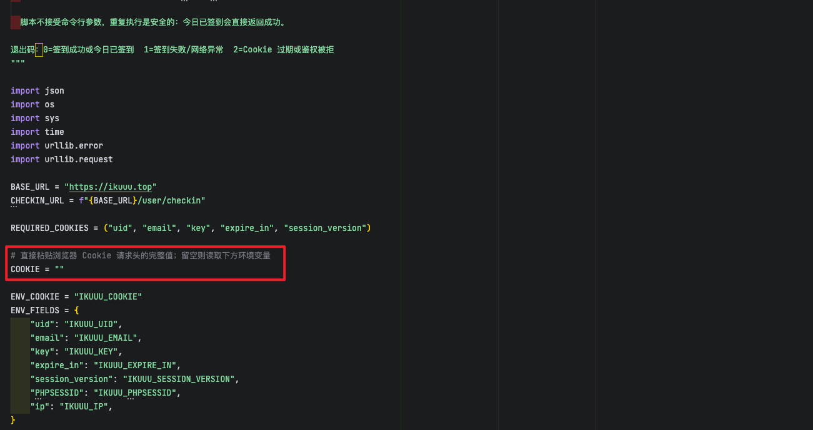
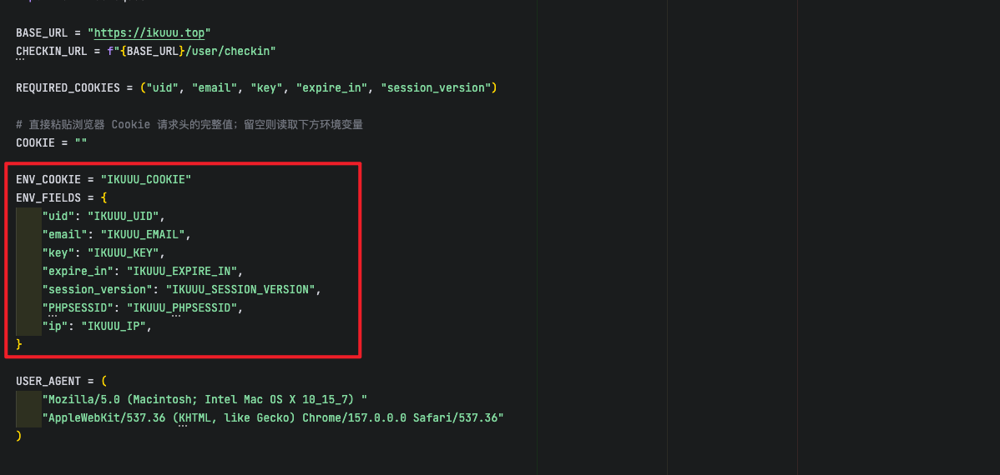

# iKuuu 自动化脚本

本目录包含 iKuuu VPN 每日签到脚本，通过登录后的 Cookie 调用签到接口，仅依赖 Python 标准库。

## 脚本说明

| 脚本                                     | 用途                                     | 依赖         |
| -------------------------------------- | -------------------------------------- | ---------- |
| [`ikuuu_checkin.py`](ikuuu_checkin.py) | 调用 `POST /user/checkin` 完成每日签到，重复执行安全。 | Python 标准库 |

## 环境要求

- Python 3.8 或更高版本。
- 已有可用的 iKuuu 账号，并在浏览器中完成过一次登录。

## 使用步骤

### 1. 登录 ikuuu

打开 `https://ikuuu.top` 后，输入邮箱、密码，勾选「记住我」，然后点击登录按钮。

> 注意：“记住我”选项建议勾选，有效期约 7 天，未勾选约 24 小时。



### 2. 获取 Cookie

打开开发者工具，选择「Network」，刷新页面后，获取到的 Cookie 请求头的完整值。



### 3. 配置 Cookie

方式一，写入脚本顶部常量 [`ikuuu_checkin.py`](ikuuu_checkin.py) 的 `COOKIE`：

```python
COOKIE = "uid=...; email=...; key=...; expire_in=...; session_version=..."
```



方式二，使用环境变量（推荐，避免真实凭据进入仓库）：

```bash
# 整串
export IKUUU_COOKIE='uid=...; email=...; key=...; expire_in=...; session_version=...'

# 或按字段拆分，PHPSESSID / ip 可选
export IKUUU_UID='...'
export IKUUU_EMAIL='...'
export IKUUU_KEY='...'
export IKUUU_EXPIRE_IN='...'
export IKUUU_SESSION_VERSION='...'
```



优先级：脚本内 `COOKIE` > `IKUUU_COOKIE` > 分字段环境变量。

### 3. 执行签到

```bash
python3 ikuuu_checkin.py
```

脚本会用 `expire_in` 预判过期，过期时不发请求直接报错；当天已签到时输出「今日已签到」，退出码仍为 0。

退出码：`0` 签到成功或今日已签到，`1` 配置/网络/响应异常，`2` Cookie 过期或鉴权被拒。

## 敏感信息

仓库中的脚本不包含真实凭据，`COOKIE` 默认为空，需要在本机填写后使用。

`uid`、`email`、`key`、`expire_in`、`session_version` 均属账号凭据，其中 `key` 泄露等同于账号被登录，不要将真实值提交到代码仓库、公开日志或聊天中。
